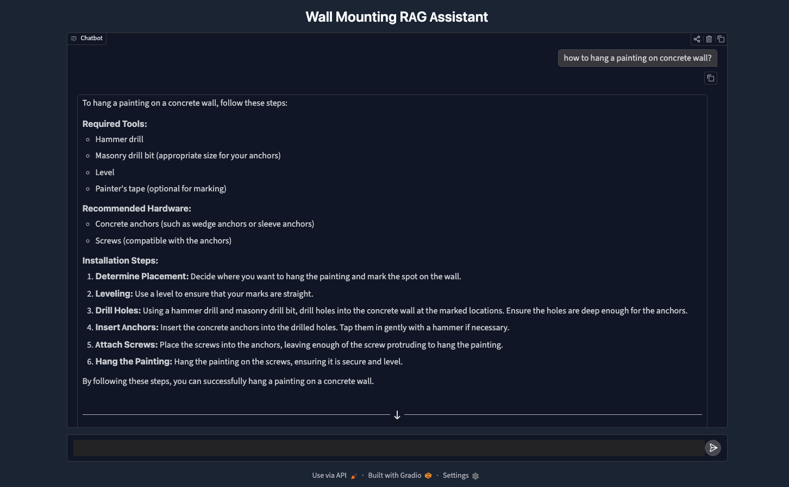
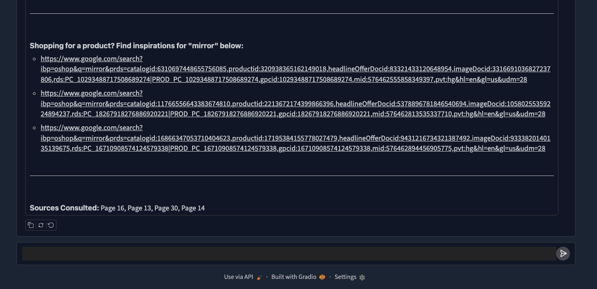

# Assignment 2: Wall Mounting Guide

The purpose for this AI Assistant is to provide guidance on mounting various types of objects on drywall or concrete walls. 

In the response to the user, assistant provides guidance with regards to the Required Tools, Recommended Hardware and Installation Steps.

## Services

### Service 1: Document Processing & Embeddings

The original guidance was drafted on a pdf document A-Z Wall Mounting.pdf.

#### Embedding consisted of the following steps

**1. Text Cleaning**

**2. Document Chunking**
chunk_size=1200
chunk_overlap=200
The overlap helps preserve contextual information between neighboring chunks.

**3. Embedding Generation**
The application uses the Hugging Face embedding model:
BAAI/bge-small-en-v1.5
The embedding model converts each document chunk into a numerical vector representation.
embeddings = HuggingFaceEmbeddings(model_name="BAAI/bge-small-en-v1.5")

**4. ChromaDB Vector Store**
The document chunks and their embeddings are stored locally in ChromaDB.
The vector database uses:

- Collection: a_z
- Persistent directory: ./chroma_db_a_z
- Batch size: 100
The chunks are processed in batches and added to the same persistent ChromaDB collection.

**5. Semantic Search Retriever**
After the vector database was created, it was converted into a retriever:
retriever = vectorstore.as_retriever(search_kwargs={"k": 3})

**6. JSONL Batch Preparation**
The prepared document chunks were converted into JSONL format.

The batch preparation process:

1. Receive the previously generated document chunks.
2. Divide them into files containing up to 1,000 entries.
3. Preserve metadata including page number, sequence number, and start index.
4. Create a unique custom_id for each chunk.
5. Store the chunk content as an embedding request.
6. Write each request as an individual JSON object in a .jsonl file.
Each generated request specifies:
Model: text-embedding-3-small
Endpoint: /v1/embeddings
The resulting files follow the naming convention:
a_z_wall_mounting_1.jsonl
a_z_wall_mounting_2.jsonl
and so on as required by the number of document chunks.

### Service 2: Semantic Search & RAG

The application uses semantic search to retrieve relevant information from the A-Z Wall Mounting Guide based on the meaning of the user's question.
A ChromaDB retriever is initialized when the application starts:
retriever = initialize_vectorstore()
When the user submits a question, the retriever performs the semantic search:
retrieved_docs = retriever.invoke(message)
The retrieved document chunks are then combined into the context supplied to the language model:
context_str = format_docs(retrieved_docs)
The RAG pipeline therefore follows this process:
User Question → Semantic Search → Relevant Document Chunks → Context → LLM Response
The language model generates its response using the retrieved context rather than relying on the document as a whole.

### Service 3: Product Search
The application identifies the object being mounted from the user's message and uses it as a search term for the SerpAPI Google Shopping service.
Relevant product links returned by the shopping search are displayed alongside the assistant's response.

### Guardrails
Guardrails are implemented within the RAG prompt to keep responses grounded in the A-Z Wall Mounting Guide.
The assistant is instructed to:

- Use only information contained in the retrieved context.
- Avoid guessing, assumptions, or outside knowledge.
- Match recommendations to the specified wall substrate.
- Use only applicable tools, anchors, fasteners, and installation instructions.
- Keep recommendations from different wall substrates separate.
- Return a refusal when the retrieved context does not contain enough information to provide an applicable recommendation.
